# Практическая работа № 2
## Локализация игрового контента («Морской бой», Unity)

**Языки:** русский (исходный) + английский (регион: Германия/Польша, см. отчёт № 1).

## 1. Подготовка проекта

Вместо ручной настройки пакета Localization реализована собственная лёгкая система, не требующая правки каждой сцены (13 сцен проекта). Файлы:

| Файл | Назначение |
|---|---|
| `Assets/Scripts/Localization/Loc.cs` | Хранение языка (`PlayerPrefs["Language"]`, 0 = RU, 1 = EN), таблица переводов, события смены языка |
| `Assets/Scripts/Localization/LocalizationManager.cs` | Автозапуск при старте; переводит все `TMP_Text` на любой сцене; рисует кнопку переключения RU/EN |
| `Assets/Scripts/ServerConfig.cs` | (смежное) единая точка настройки адресов сервера |

### Задание 1.2 — переключатель языка
Кнопка «RU/EN» создаётся менеджером автоматически и показывается на всех сценах (нижний левый угол). По нажатию вызывается `Loc.Language = ...`: язык сохраняется в `PlayerPrefs`, интерфейс обновляется мгновенно. Аналог примера из методички (`LanguageManager.SetLanguage`), но без ручной привязки Dropdown в каждой сцене.

## 2. Локализация UI-текстов

Все надписи сцен (кнопки «ОНЛАЙН-ИГРА», «ИГРА С БОТОМ», «НАСТРОЙКИ», «ВЫХОД», заголовки, поля ввода, подсказки) собраны в таблицу `Loc` (≈ 130 пар). Ключом служит исходная русская строка (пробелы нормализуются), поэтому сцены править не нужно.

Примеры:

| RU | EN |
|---|---|
| ОНЛАЙН-ИГРА | ONLINE GAME |
| ИГРА С БОТОМ | PLAY VS BOT |
| НАСТРОЙКИ | SETTINGS |
| ВЫХОД | EXIT |
| АВТОРИЗАЦИЯ | SIGN IN |
| РАССТАНОВКА ФЛОТА | FLEET PLACEMENT |

### Задание 2.2 — таблица переводов
Роль `SimpleLocalization` из методички выполняет `Loc` (словарь `ru → en` + регулярные выражения для строк с числами: «ШАГ 3 / 10» → «STEP 3 / 10», «Размещено: 12/20 клеток…» → «Placed: 12/20 cells…»). Для динамических сообщений из кода доступен `Loc.T("русский текст")`.

## 3. Локализация игровых элементов

Системные и игровые сообщения: «Твой ход / Your turn», «Ход противника / Opponent turn», «Ты победил! / You won!», «Победа / Victory», «Поражение / Defeat», статусы режима с ботом, ошибки расстановки флота, подписи статистики и рейтинга.

### Задание 3.2 — динамическое обновление
Аналог `LocalizedText`: менеджер каждые 0,2 с проверяет `TMP_Text`; если игровой код записал в текст новое русское сообщение (например, статус хода), оно запоминается как исходное и отображается на текущем языке. Для каждого текста хранится оригинал, поэтому переключение RU ↔ EN обратимо и без потерь.

## 4. Тестирование

| Проверка | Как проверять | Статус |
|---|---|---|
| Переключение RU/EN на каждой сцене | Нажать кнопку в MainMenu, Auth, Settings, Statistic, ShipsAssigment, BotGame, Tutorial | проверено в Play Mode, см. скриншоты |
| Тексты помещаются в кнопки | Визуально; английские строки короче русских | OK по скриншотам |
| Сохранение языка | Выбрать EN, перезапустить игру | `PlayerPrefs["Language"]` |
| Динамические сообщения | Сыграть партию с ботом на EN | OK |

### Скриншоты проверки

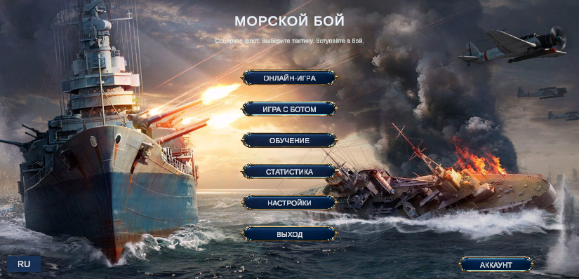

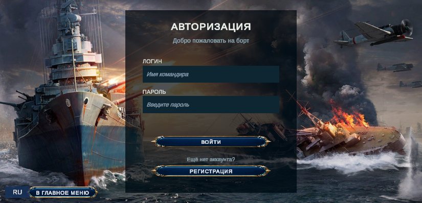

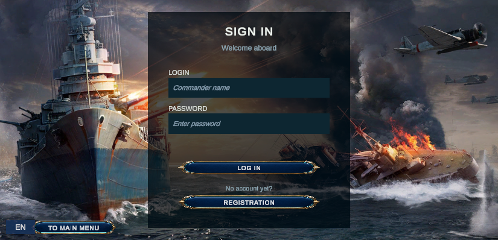

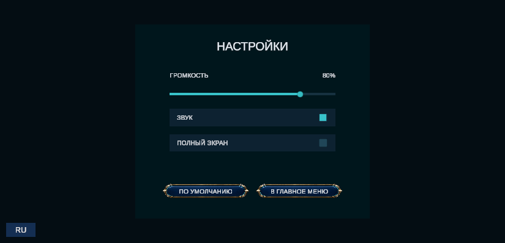

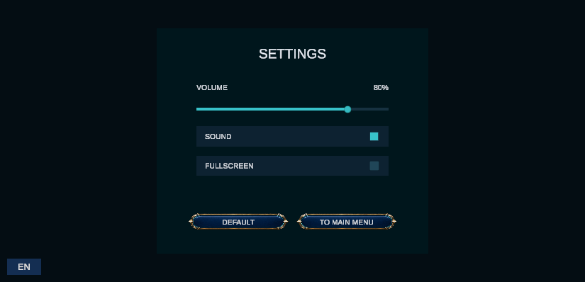

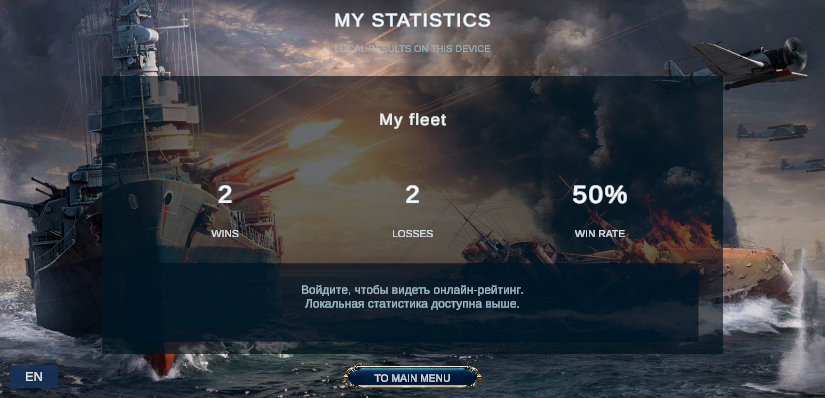

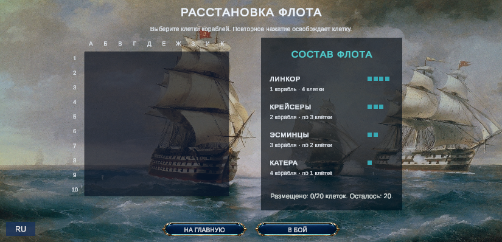

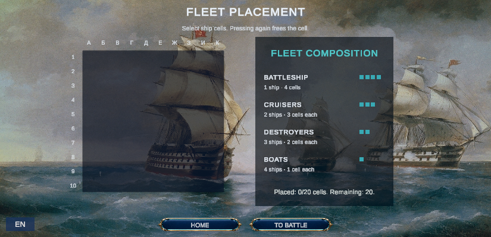

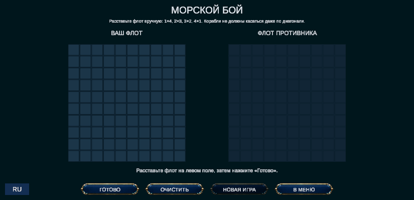

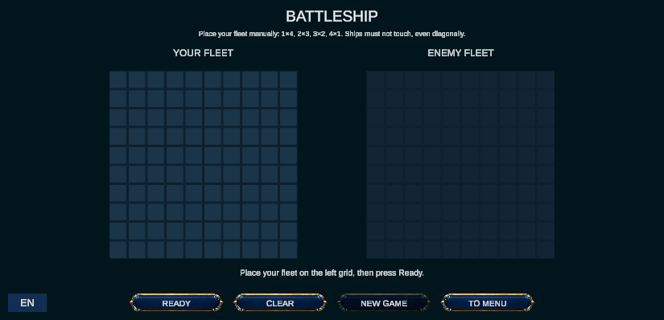

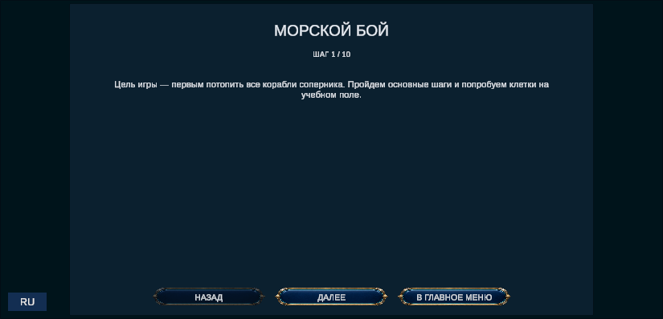

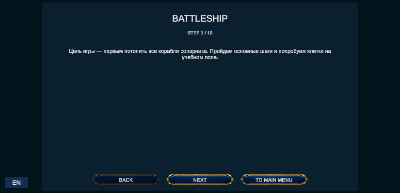

## 5. Критерии оценки
- [x] Главное меню переведено на оба языка
- [x] Игровой интерфейс отображает выбранный язык
- [x] Системные сообщения переводятся
- [x] Выбор языка сохраняется между запусками
- [x] Кнопка языка — отдельный элемент, не перекрывает интерфейс (нижний левый угол)

## 6. Выводы
Реализована двуязычная версия (RU/EN) с централизованной таблицей строк, автоматическим применением ко всем сценам и сохранением выбора. Решение расширяется добавлением языка в `Loc`.
