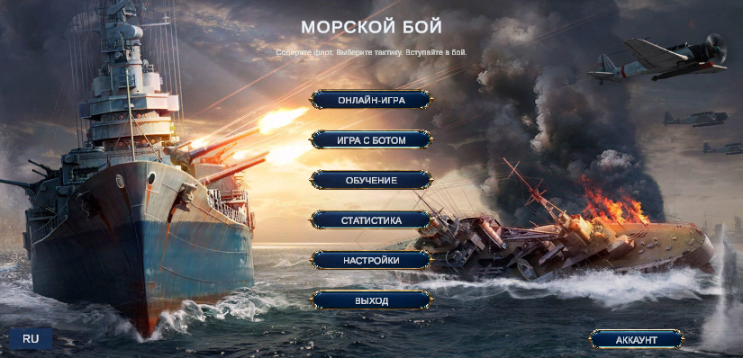
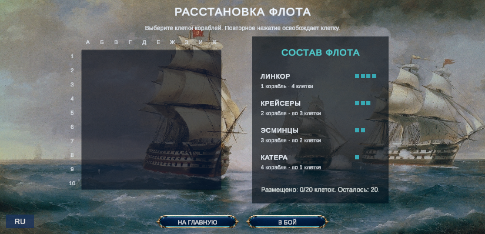
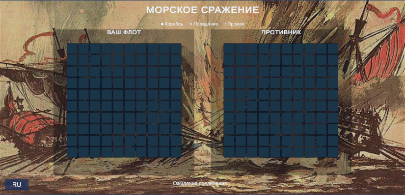
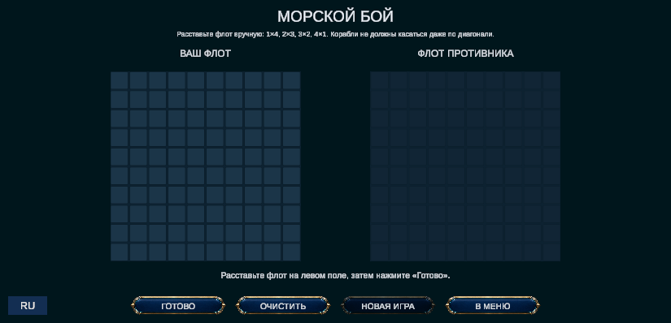
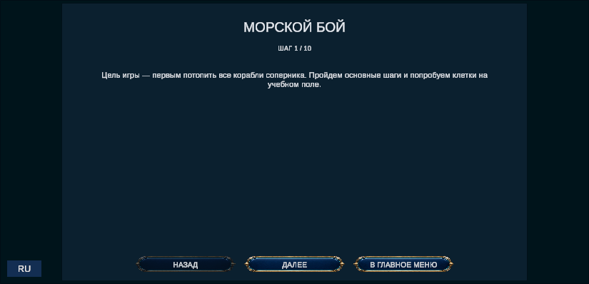
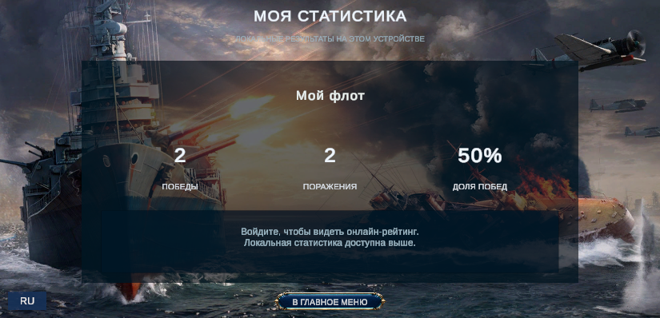
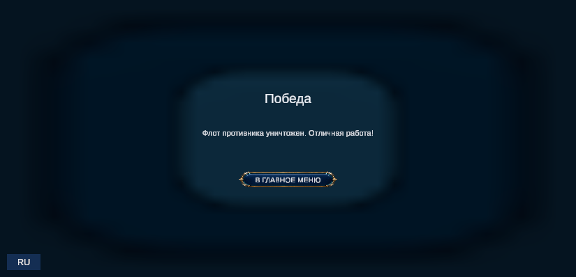

# Практическая работа № 4
## Особенности продвижения игрового контента на игровых площадках: страница игры на itch.io

## 1. Подготовка материалов

**Медиа-контент:**
- 8–12 скриншотов: главное меню → расстановка флота → бой онлайн → бой с ботом → обучение → статистика → экран победы;
- вертикальные скриншоты для мобильных (план);
- геймплей-трейлер 30–60 секунд (экран боя, смена хода, потопление корабля);
- иконка 512×512, баннер страницы 1200×630.

**Последовательность скриншотов:** 1) Главный экран — первое впечатление; 2) Расстановка флота — основная механика; 3) Бой — драйв; 4) Бот/обучение — доступность; 5) Статистика/рейтинг — прогресс; 6) Победа.

**Скриншоты игры для страницы:**

## 2. Оформление страницы

**Название:** Battleship Online — Naval Duel
**Тип проекта:** Games, Downloadable (Windows) + возможность WebGL.
**Краткое описание:** Classic Battleship with online duels, a smart bot and a rating system. / Классический «Морской бой» с онлайн-дуэлями, ботом и рейтингом.

**Полное описание (шаблон):**
> **Battleship Online** — классика, переосмысленная для современного игрока.
> • Онлайн-матчи с реальными соперниками
> • Игра с ботом без интернета
> • Обучение за 2 минуты
> • Локальная статистика и онлайн-рейтинг
> • Интерфейс на русском и английском
> **Системные требования:** Windows 10+, 4 ГБ RAM, интернет для онлайн-режима.
> **Установка:** скачайте архив, распакуйте, запустите `Battleship.exe`.
> **Контакты:** ссылка на сообщество ВК.

**Теги и категории:** `strategy`, `board-game`, `multiplayer`, `turn-based`, `casual`, `2d`.
Первые 15 секунд — главная связка: баннер + короткое описание + GIF боя.

## 3. SEO и конверсия

- Ключевые слова: battleship, naval, turn-based, multiplayer, русский морской бой.
- Название и подзаголовок содержат основные запросы.
- Превью для соцсетей: баннер 1200×630.

**Примеры базовых тегов:** `strategy`, `multiplayer`, `turn-based`, `board-game`, `casual`, `singleplayer`.

## 4. Стратегия продвижения на платформе

- Отвечать на комментарии 5–7 игроков в первую неделю;
- Devlog с обновлениями (новости, баланс бота, локализация);
- Участие в game jam (тематика «море»/«настолки»);
- Добавление в коллекции, взаимные кросс-промо с другими инди.

**Целевые метрики:** 500+ просмотров, 10% конверсия в загрузки, 20+ избранных, рейтинг 4.0+.

## 5. Аналитика
Использовать статистику itch.io (просмотры, загрузки, источники трафика), A/B тест скриншотов (меняем первые 2 и сравниваем конверсию), анализ комментариев.

## 6. Баллы
Визуальное оформление — 25, контент и описание — 25, техническая настройка — 20, SEO — 15, активность — 15 (итого 100).

